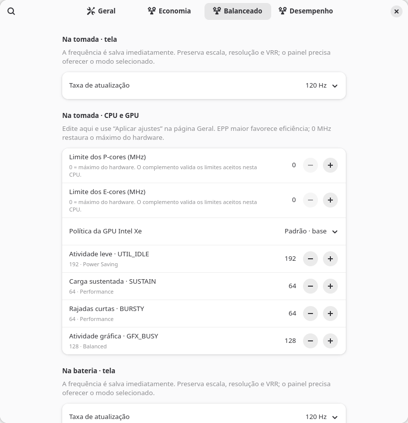

# Power Profiles & Refresh Rate

Extensão para GNOME Shell 50 com um editor de perfis de energia e controle
da frequência do painel interno. Cada perfil tem ajustes separados para
tomada e bateria.

| Perfil | Frequência padrão |
| --- | --- |
| Economia de energia | 60 Hz |
| Balanceado | 120 Hz |
| Desempenho | 120 Hz |

As preferências permitem escolher 60 ou 120 Hz para cada perfil e alimentação. A extensão
preserva a resolução, a escala, o VRR, a posição dos monitores e a configuração
dos monitores externos. Usa sinais D-Bus e dispensa um serviço Python permanente.

## Requisitos

- GNOME Shell 50 em Wayland.
- Um serviço compatível com a API `org.freedesktop.UPower.PowerProfiles`, como
  `power-profiles-daemon`.
- Painel interno com modos de 60 e 120 Hz na resolução e configuração de VRR
  em uso. Outros alvos não são configuráveis nesta versão.
- A escala atual deve ser aceita pelo Mutter nos modos selecionados.

A extensão acompanha o perfil ativo. Sem complemento de sistema, controla
somente a tela. Com o [complemento opcional](system/README.md), as preferências
editam os quatro EPP, limites P/E e política GPU por perfil e alimentação,
além do EPP dinâmico/fixo no Desempenho. Alterações de sistema exigem o botão
Aplicar e autenticação administrativa. O turbo permanece permitido.

## Instalação

A versão 0.2 inclui o editor de perfis. O ZIP mantém o UUID anterior para
preservar as preferências da versão 0.1. O complemento de sistema é distribuído
separadamente no arquivo `power-profile-settings-backend.tar.gz` da release.

Baixe o arquivo `.shell-extension.zip` da página de
[releases](https://github.com/mcdalbu/power-refresh-rate/releases) e instale:

```sh
gnome-extensions install --force power-refresh-rate@mcda.local.shell-extension.zip
```

Saia e entre na sessão para o GNOME descobrir a nova extensão. Depois:

```sh
gnome-extensions enable power-refresh-rate@mcda.local
gnome-extensions prefs power-refresh-rate@mcda.local
```

Também é possível ativar, desativar e abrir as preferências pelo aplicativo
**Extensões** do GNOME. As preferências mostram o estado e o diagnóstico de falhas.

### Instalar a partir do código

Com `make` e as ferramentas de extensões do GNOME instalados:

```sh
git clone https://github.com/mcdalbu/power-refresh-rate.git
cd power-refresh-rate
make build
make install
```

O pacote é gerado em `dist/`. O UUID é `power-refresh-rate@mcda.local`.

## Editor de perfis

Abra as preferências e escolha Economia, Balanceado ou Desempenho. Cada página
tem seções para tomada/bateria. A tela é salva imediatamente. Para EPP/CPU/GPU,
revise as alterações e use **Aplicar ajustes** na página Geral. O valor 0 MHz
significa máximo do hardware. Os valores atuais são preservados na instalação.

O complemento exige a implantação PPD/LPMD existente; veja
[instalação, permissões e reversão](system/README.md). Instalar o ZIP sozinho
não instala serviços de root. Após atualizar uma extensão já carregada, saia
e entre na sessão para carregar seu novo código.

## Comportamento

O controlador acompanha mudanças de perfil, monitores e disponibilidade da
tela. Antes de aplicar, pede ao Mutter que valide o layout completo. A aplicação
é temporária, sem gravar uma nova configuração em `monitors.xml`.

A extensão escolhe um modo com a mesma resolução e configuração de VRR.
Se não encontrar o modo ou a escala não for aceita, preserva a configuração
atual e mostra o erro nas preferências. Desativar a extensão cancela operações
pendentes e deixa a tela no modo atual.

Trocar os modos físicos de 60 e 120 Hz pode causar um breve apagão. Esta
extensão usa essa troca de modo; não altera os limites do intervalo de VRR.

### Escalas personalizadas, incluindo 180%

A extensão preserva as escalas anunciadas e aceitas pelo Mutter; ela não
acrescenta opções de escala ao compositor. Em versões que não oferecem 180%,
essa escala precisa ser disponibilizada separadamente. Uma configuração antiga
carregada em 180% pode continuar visível enquanto a API rejeita alterações de
frequência. Nesse caso, as preferências mostram um diagnóstico específico.

O complemento nativo de escala usado na configuração local de desenvolvimento
é independente desta extensão e não faz parte deste repositório.

### Migração do serviço anterior

Se estiver usando `power-refresh-rate.service`, pare e desabilite esse serviço
antes de ativar a extensão, para manter um único controlador:

```sh
systemctl --user disable --now power-refresh-rate.service
```

## Testes

Os testes usam GJS, GLib e um barramento D-Bus privado sem ativação automática
de outros serviços. Não trocam os perfis ou modos da sessão real:

```sh
make test
```

Cobrem os três perfis, validação antes de aplicar, escala de 180%, VRR,
monitores externos, conectores em lease, atualização de preferências,
recuperação de falhas e limpeza ao desativar.

Um teste adicional inicia um GNOME Shell virtual e verifica carregamento,
desativação, reativação e a janela GTK/Adwaita de preferências:

```sh
make test-shell
```

O teste virtual foi preparado para Fedora com GNOME Shell 50, Python/PyGObject
e as bibliotecas do aplicativo Extensões instalados. A integração foi testada
em GNOME Shell 50.5 e Mutter 50.6. A primeira versão foi validada com serviços
simulados e uma sessão virtual; a validação no painel físico continua pendente.

## Implantar os perfis de energia em outro Fedora

O [guia de implantação](docs/fedora-energy/README.md) documenta a configuração
complementar de PPD, Intel LPMD, EPP dinâmico por perfil e alimentação, limites
de CPU e política da GPU Intel Xe. Inclui adaptação ao hardware, validação e
reversão. As tabelas são personalizadas e não representam recomendações
universais para qualquer processador.

Os scripts, unidades systemd, testes e a extensão estão no
[pacote de implantação](docs/implementacao-fedora.tar.gz), também disponível
como arquivos em `docs/fedora-energy/`. Esses serviços são opcionais e
instalados separadamente. O novo editor usa o complemento de `system/` para
gerenciar a implantação; instalar somente o ZIP não instala os controladores.

## Desenvolvimento

- `extension.js`: ciclo de vida da extensão.
- `controller.js`: sinais D-Bus, reconciliação e cancelamento.
- `policy.js`: seleção de modos e preservação do layout.
- `prefs.js`: frequências por perfil e diagnóstico.
- `schemas/`: configurações GSettings.
- `tests/`: política, controlador e integração em sessão virtual.

## Janela de preferências



Captura em uma sessão GNOME isolada; os valores iniciais seguem a implantação
de referência. Cada máquina continua exigindo a validação do hardware descrita
no guia.

### Nomes dos valores EPP

O editor mostra nomes ao lado dos números: 0 Maximum Performance, 32 High
Performance, 64 Performance, 96 Responsive, 128 Balanced, 160 Efficient,
192 Power Saving, 224 Maximum Savings e 255 Full Economy. Outros números
continuam aceitos e aparecem como Custom value, sem arredondamento. Esses
nomes são rótulos da interface; o kernel continua recebendo o EPP numérico.
